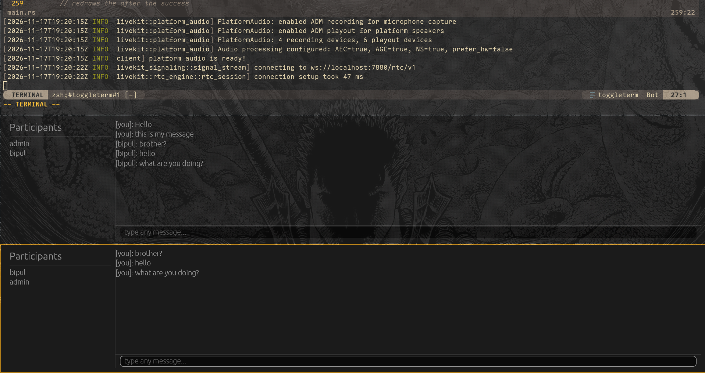

# Livekit rust sdk and egui experimentation 
The livekit server is setup with `livekit-server`.

start the server with: 

```
livekit-server --dev --bind 0.0.0.0
```




[X] setup with rust sdk with livekit server 
[X] pretty basic client with rooms to share text? (signaling setup)
[X] stream media over the media backend plane just capture the host audio and transmit 


### References
- https://docs.livekit.io/transport/self-hosting/local/
- https://github.com/dburiachkovskyi/livekit-example/blob/master/docker-compose.yml
- https://github.com/ar37-rs/eframe_tokio_app
- https://github.com/livekit/rust-sdks/blob/main/examples/basic_room/src/main.rs

